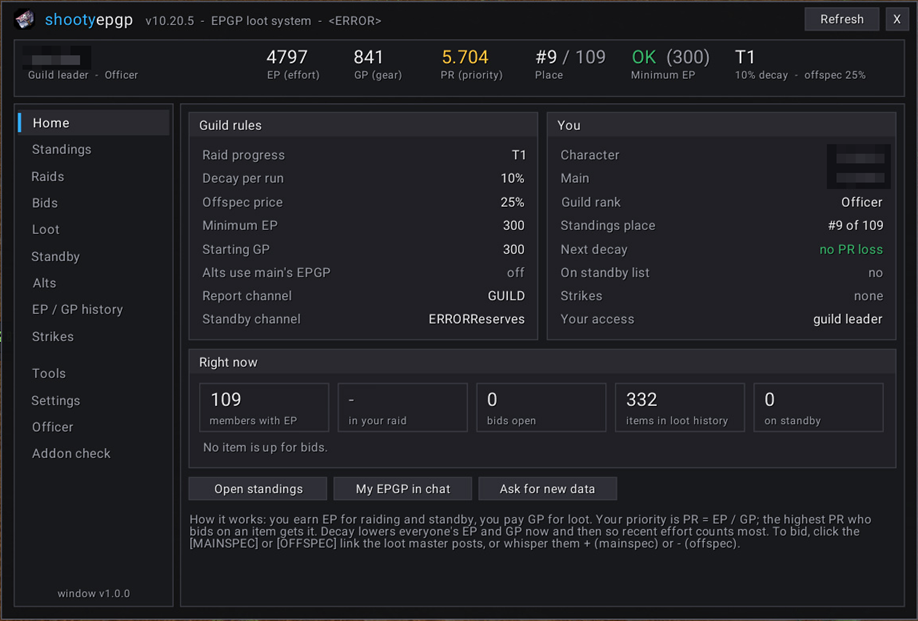
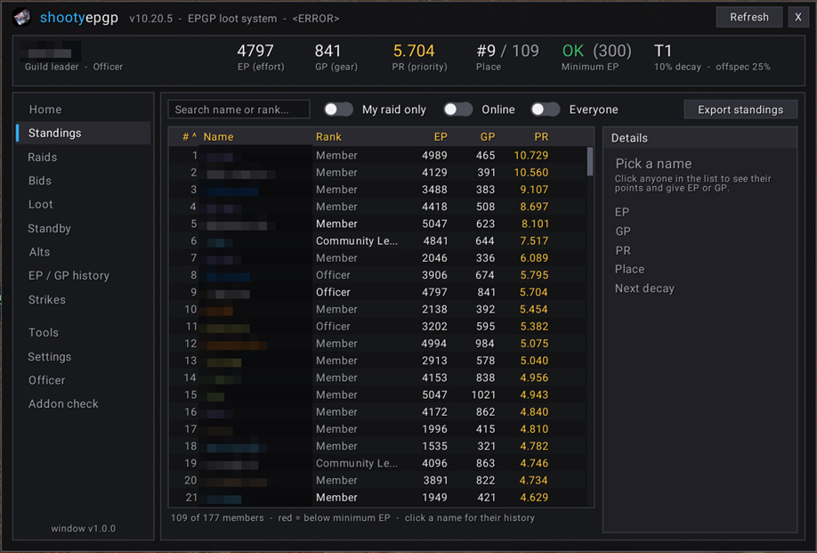
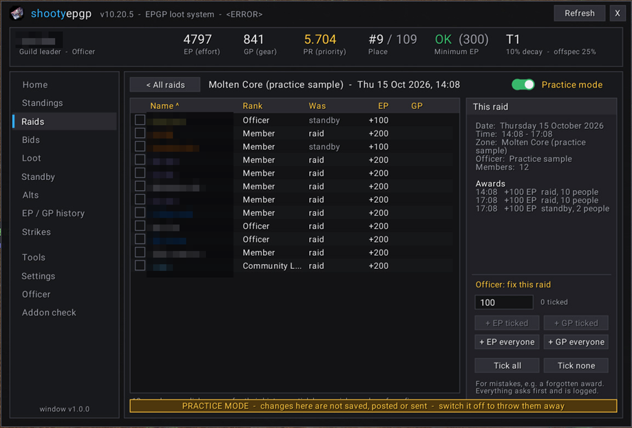
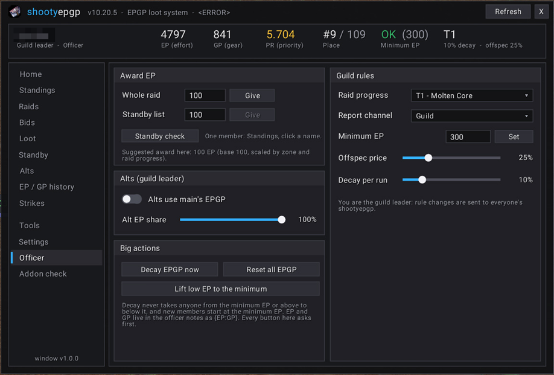
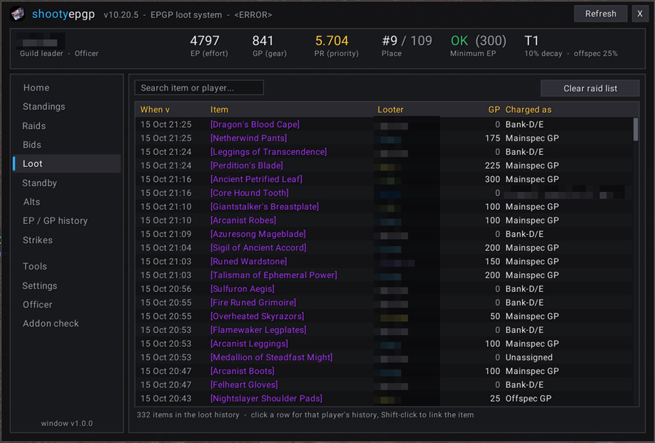
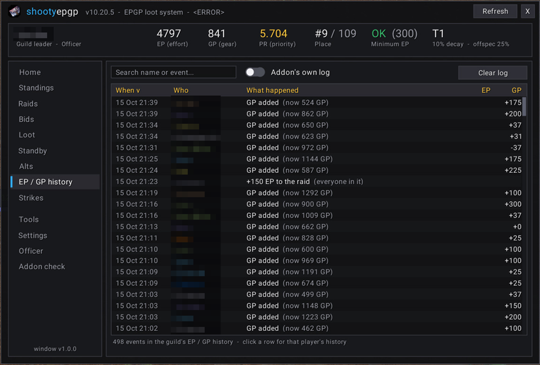
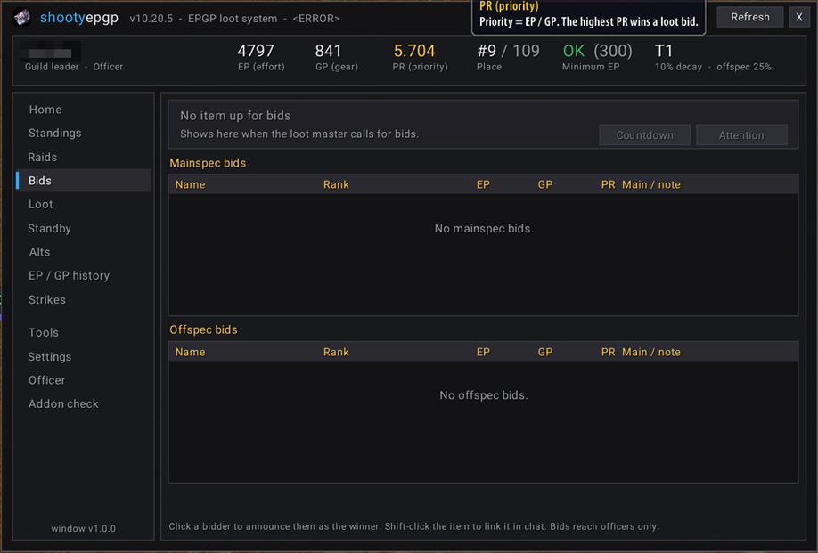
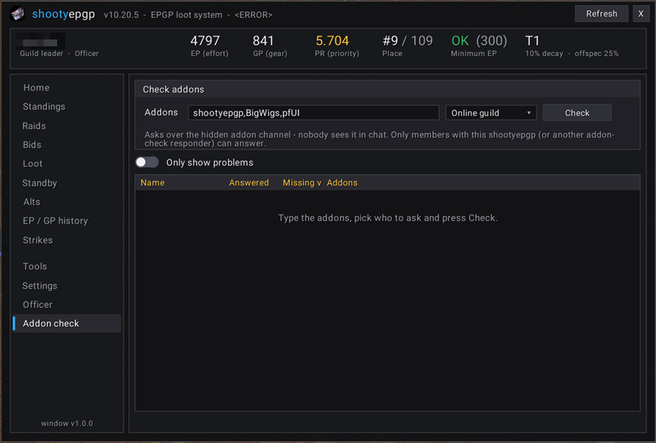
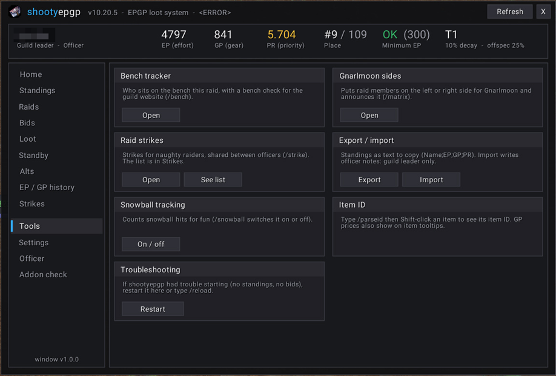
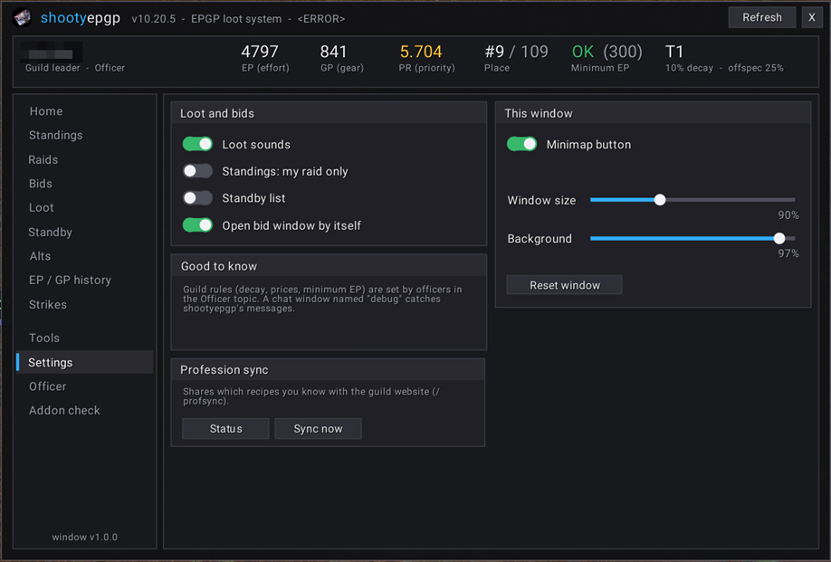

# shootyepgp - with a new, easy window

EPGP loot system for World of Warcraft **1.12** (Turtle WoW / OctoWoW style 1.12.1 clients), with
**one clean window for everything**: standings, every player's loot and EP / GP history, raids,
bids, standby, officer tools and settings - opened from a single minimap button.

This is [Road-block's shootyepgp](https://github.com/Road-block/shootyepgp) as extended for a Turtle
WoW guild (Turtle item prices, OS PRIO bids, strikes, bench check, Gnarlmoon sides, profession
sync), plus a new interface built in the same flat style as the OctoBG addon. Nothing about how EPGP
is stored changed: your guild's points stay in the officer notes.

| | |
|---|---|
| **Home**  | **Standings**  |
| **A raid (officer view, practice mode)**  | **Officer**  |
| **Loot history**  | **EP / GP history**  |
| **Bids**  | **Addon check**  |
| **Tools**  | **Settings**  |

Character names are hidden in every picture.

---

## Install

1. Download this repository (**Code > Download ZIP**).
2. Unzip it into `World of Warcraft\Interface\AddOns\` and rename the folder to exactly **`shootyepgp`**
   (remove `-main` or `-master` from the name).
3. If you had an older shootyepgp, replace its folder. **Your saved data is kept** - it lives in the
   `WTF` folder, not in the addon folder.
4. Log in. Click the guild-charter button on the minimap, or type **`/epgp`**.

The guild leader sets guild permissions once: officer notes **visible to everyone**, editable **only
by officers**. Public notes are not used.

---

## How EPGP works (in one minute)

- **EP (effort points)** - earned by raiding and by being on standby.
- **GP (gear points)** - added when you receive loot. Everyone starts at the guild's starting GP.
- **PR (priority) = EP / GP.** When an item is up for bids, the highest PR wins.
- **Decay** lowers everyone's EP and GP now and then, so recent effort counts most.
- **Minimum EP** - members below it are listed after everyone above it in standings and bids.

To bid, click **[MAINSPEC]** or **[OFFSPEC]** in the loot master's raid message, or whisper them `+`
(mainspec) or `-` (offspec). The addon is not needed to bid - but it makes everything easier.

---

## The window

Open it with the **minimap button** (left-click; right-click goes straight to Standings; drag to move)
or **`/epgp`**, **`/epgp <topic>`** (e.g. `/epgp raids`). The old `/shooty` commands still work and
open the same window.

The top bar always shows **your** EP, GP, PR, your place in the standings, whether you are above the
minimum EP, and the guild's settings (raid tier, decay, offspec price). Alts see their main's points.

### For everyone

| Topic | What it shows |
|---|---|
| **Home** | Your character, main, rank, place, what the next decay does to your PR, standby status, strikes; the guild's rules; "right now" (members, raid, loot in history) and a short how-to. |
| **Standings** | The whole guild's EP / GP / PR in the addon's order. Search by name or rank, *My raid only*, *Online*, *Everyone* (also 0 EP), sortable columns, export as text. **Click a name** to see that player's details and their **history**: every loot item, EP award, GP charge, raid correction and decay, with *All / Loot / EP-GP* tabs (their alts included). |
| **Raids** | Every raid that got EP: date, zone, officer, members, awards, EP each and total. Click a raid to see who was there (raid or standby) and what each person got; click a member for their history. Two groups raiding on the same night are kept apart. |
| **Loot** | The guild's loot history: when, which item (hover for its tooltip), who got it, GP and how it was charged. Click a row for that player's history. |
| **Standby** | Join the standby list and set your main. Answer an officer's standby check to get standby EP. |
| **EP / GP history** | Every EP and GP award, penalty, decay and reset in the guild, newest first, searchable. |
| **Settings** | Loot sounds, standings filter, standby, profession sync (share your recipes with the guild website), the minimap button, window size and background. |

### For officers only

These topics and buttons are hidden from members. **Officer** folds open: click it to show Addon check and Accounts under it, click again to hide them. "Officer" means a guild rank that can **edit
officer notes** (the same rule shootyepgp has always used).

| Topic | What it does |
|---|---|
| **Standings** (details) | Give or take EP / GP from one member (a minus is a penalty). |
| **Raids** (open a raid) | **Fix a raid afterwards** - e.g. an award an officer forgot: tick members (or use *everyone*) and give or take EP / GP. It is logged and shows in each member's history as a *raid correction*. |
| **Bids** | The item up for bids, its GP price, mainspec and offspec bidders with their PR. Click a bidder to announce the winner. Loot master: countdown and attention ping. |
| **Standby** | Who answered the standby check, run a standby check, give standby EP. |
| **Alts** | Which characters are alts of which mains (`{MainName}` in the alt's officer note). |
| **Strikes** | Raid strikes and the strike panel (`/strike`). |
| **Officer** | Award EP to the raid or standby; raid progress tier; report channel; minimum EP; offspec price; decay %; alts sharing EP (guild leader); **Decay now**, **Reset all EPGP** (guild leader), **Lift low EP to the minimum**. |
| **Version counter** (top right, next to Refresh) | How many online members run this version, e.g. *9 / 14 online up to date*. Hover for who is up to date, who **needs to update** (with their version when known) and who has no shootyepgp answering; click to ask again. Old copies (since March 2026) are found through the hidden check every shootyepgp already answers. |
| **Addon check** (inside Officer) | Ask your raid, party or the online guild which addons they have loaded (green = loaded with version, yellow = installed but off, red = missing). Nothing appears in chat. |
| **Accounts** (inside Officer) | Every guild member's other characters on the same WoW account, **Alliance and Horde**: faction, class, level, guild and realm (hover a row). Search for any character name to find who owns it. Each member's shootyepgp remembers the characters logged in on that account and sends the list when they log in; **Ask online members** asks everyone online now. A character only shows once it has been logged in with this version. |
| **Tools** | Bench tracker, Gnarlmoon sides, strike panel, standings export / import (import: guild leader only), snowball tracking, item ID lookup, restart. |

Every button that changes points, clears a list or posts to chat opens a **confirm box in the middle
of the screen** that says exactly what will happen. Nothing happens until you press *Yes*.

---

## Guild rules built in

- **EP never decays below the minimum EP.** A member at or above the minimum (e.g. 300) stops at it
  when a decay runs. Members already below it decay as before. Officer penalties are not limited.
- **New members start at the minimum EP**, not 0, when they get their first EPGP note.
- **Lift low EP** (Officer page) raises everyone between 1 and the minimum up to the minimum, after a
  confirm.

These follow the guild's *Minimum EP* setting. They are applied by the copy of the addon that does
the writing, so **every officer who awards points or runs a decay should use this version**.

---

## Where the data lives (and why nothing is lost)

| Data | Where | Shared how |
|---|---|---|
| EP and GP | Guild officer notes, as `{EP:GP}` | The game server |
| Settings (tier, decay, offspec, minimum EP, alts) | Each player's saved variables | The guild leader's copy sends them to everyone |
| Loot list, EP / GP log | The loot master's / officers' saved variables | Read into the history (below) |
| **History** (loot, awards, raids) | `sepgp_history`, saved per guild on each PC | The guild addon channel (below) |
| **Account characters** | `sepgp_accounts` on each PC: this account's characters, and (officers only) the lists members sent | The guild addon channel, prefix `SEPGPAC` |
| Who runs which version | `sepgp_ui.versions`: versions heard from other members | The guild addon channel, prefix `SEPGPV` (and the old `SWOW_Q` check) |

The plain addon only writes loot on the loot master's PC and EP / GP lines on officers' PCs, so a
member's copy knew almost nothing about other players. This version keeps a **history store** on
every PC and fills it from: the PC's own loot list and log; the award and decay messages shootyepgp
already sends to the guild; and officers' copies, which also send loot charges and the names in raid
and standby awards. When a member opens a player's history or the raid list, their copy asks the
guild and **one** officer's copy that is online answers. Older raid awards were logged without names
("100 EP to the raid"), so those raids show date and EP but no member list.

**All saved-variable names are still declared** (removing one would make the game drop that data).
Updating from an older shootyepgp keeps everything.

### Addon messages (for developers)

All on the **GUILD** addon channel (whispers do not work on this client), paced one message at a time
and through ChatThrottleLib's BULK queue when it is loaded.

- `SEPGPH` (history): `HE;event~event` new events, `HR;t,n,kind,zone,raidid;name,name` a raid /
  standby award, `HQ;Name` / `HQ;*` / `HQ;#R` questions, `HA;Name;events` and
  `HS;kind,t,n,action,zone,raidid,officer;names` answers. Event = `k,t,n,ep,gp,item,action,name,itemname,by,zone,raidid`.
- `ADDONCHECK` (addon check, compatible with other responders using this format): query
  `Q1:<id>:<Addon1>,<Addon2>`, answer `A1:<id>:<Addon>=L/<version>;<Addon>=D;<Addon>=M`. A copy answers
  only guild / group members, at most once per asker every 10 s and 8 answers per 30 s.
- shootyepgp's own `SEPGP_PREFIX` messages are unchanged.

---

## What changed from the older shootyepgp

- New window (`ui\`), new minimap button, `/epgp`.
- The old Tablet windows (standings, bids, loot, standby, alts, logs), the FuBar minimap icon and the
  Dewdrop right-click menu were **removed** - everything they did is in the window.
  `legacy.lua` keeps what was not just a window (standings export / import, bid countdown, winner
  announcements, attention ping), and every old "open window" call opens the matching page.
- Removed libraries: Tablet-2.0, Dewdrop-2.0, FuBarPlugin-2.0, Compost-2.0.
- Decay floor at the minimum EP, new members start at the minimum EP, lift low EP.
- Shared loot and EP / GP history, per-player history, Raids with officer corrections.
- Addon check (officers).
- The "EPGP<Guild>" tag in chat and tooltips shows the player's own guild.

### Practice mode (temporary)

The Raids page has an officer-only **Practice mode** switch: a sample raid made of real guild members
and fix buttons that work in the window but **write nothing** (no officer notes, chat, log or
messages). It is meant for trying the raid fix safely and will be removed later. To remove it
yourself: delete `ui\RaidsPractice.lua` and its line in `shootyepgp.toc`.

---

## Tips

- Make a chat tab named **debug**: shootyepgp's info messages go there instead of your main chat.
- GP prices also show on item tooltips.
- `/parseid` then Shift-click an item prints its item ID.

## Tests (developers)

`tests\run_ui.ps1` runs `tests\ui_test.lua` (the window, 110 checks) and `tests\load_test.lua` (the
real addon with its Ace2 libraries loads and logs in) on a mock 1.12 client. They need the OctoBG
addon's `tests\mock.lua` and DmorphOcto's `tools\LuaHost` next to this folder; they are not needed to
play. Sample players in the tests are invented.

## Credits and licence

- **shootyepgp** by Road-block (MIT licence, see `LICENSE`), originally by shooty; zhCN by Qcat.
- Turtle WoW guild fork (prices, OS PRIO, strikes, bench, Gnarlmoon sides, profession sync) by Horyoshi.
- New window, history, raids, addon check and cleanup: bdot89.
- The addon check message format comes from a responder shared by a friend of the guild.
- Roboto font: Apache License 2.0 (`media\fonts\README.txt`).
